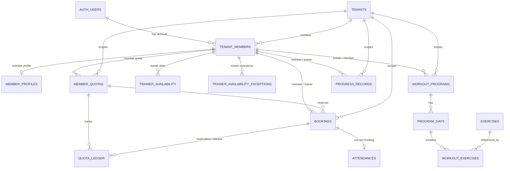

# 02 — Database ERD

> Tujuan: peta hubungan tabel dan alasan desain. Sumber DDL final ada di `03-database-schema.md` dan `supabase/migrations/`.

## Diagram Relasi

## Tabel Inti

| Tabel | Fungsi |
|---|---|
| `tenants` | Workspace PT |
| `tenant_members` | Keanggotaan user + role di tenant |
| `member_profiles` | Data fitness member per workspace |
| `member_quotas` | Konfigurasi kuota (unlimited, expiry, status) |
| `quota_ledger` | Riwayat append-only perubahan kuota |
| `bookings` | Jadwal sesi + status approval |
| `trainer_availability` | Slot mingguan trainer |
| `trainer_availability_exceptions` | Libur / override tanggal tertentu |
| `attendances` | Check-in, completion, catatan sesi |
| `exercises` | Library latihan global |
| `workout_programs` / `program_days` / `workout_exercises` | Program latihan |
| `progress_records` | Pengukuran tubuh & progress |

## Relasi Penting

| Relasi | Penjelasan |
|---|---|
| Tenant → Tenant Members | Satu workspace banyak pengguna |
| Tenant Member → Member Profile | Satu akun member satu profil per workspace |
| Member → Member Quotas | Riwayat beberapa kuota |
| Member Quota → Quota Ledger | Satu kuota banyak catatan perubahan |
| Member → Bookings | Member banyak booking |
| Trainer → Bookings | PT menangani banyak booking |
| Booking → Attendance | Maksimal satu attendance per booking |
| Booking → Quota Ledger | Booking menghasilkan reservasi / pengembalian |
| Member → Progress Records | Banyak catatan progress |

## Mengapa Quota Dipisah Dua Tabel

**`member_quotas`** = konfigurasi: berlaku sampai kapan, unlimited atau tidak, status aktif.

**`quota_ledger`** = riwayat perubahan append-only.

Contoh:

| Event | Quantity | Saldo |
|---|---|---|
| Initial quota | +12 | 12 |
| Booking approved | -1 | 11 |
| Booking approved | -1 | 10 |
| Session completed | 0 | 10 |
| Bonus from PT | +2 | 12 |
| Booking cancelled | +1 | 13 |

Saldo tersedia dihitung `Available = Σ ledger.quantity`. Jika `is_unlimited = true`, pemeriksaan saldo tidak membatasi booking.

## Catatan Integritas

- `quota_ledger` **append-only**: koreksi lewat entry `adjustment` baru, bukan edit/hapus.
- Booking harus memakai kuota milik member yang sama → composite FK `booking_quota_owner`.
- Attendance idealnya juga tenant-scoped; lihat risiko di `13-decisions-risks.md`.

## Modul Terkait

- Schema & constraint: `03-database-schema.md`
- Quota: `05-quota-engine.md`
- Booking: `06-booking-engine.md`
